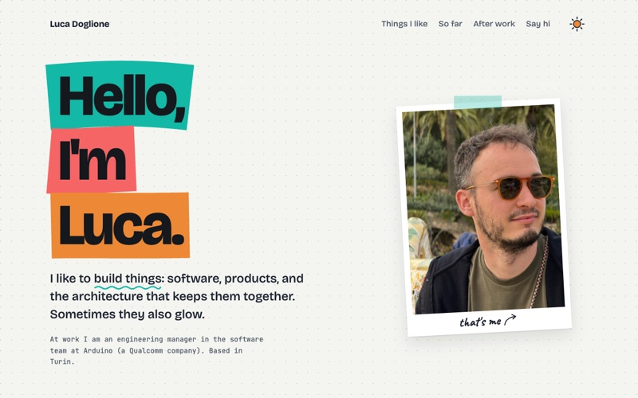

# lukdog.github.io

My personal site, drawn like a notebook: [lukdog.com](https://lukdog.com).



It is one page: what I like doing at work, the path so far, what I build after work, and how to say hi.
Most objects on the page can be touched.

## Stack

- [Next.js](https://nextjs.org) with the App Router, exported as a static site
- React and TypeScript
- [Tailwind CSS](https://tailwindcss.com) v4, with the design tokens in `app/globals.css`
- [rough-notation](https://roughnotation.com) for the hand-drawn highlighter

It is deployed to GitHub Pages by `.github/workflows/pages.yml` on every push to `main`.

## How the content works

Everything the site says lives in [`content/site.ts`](content/site.ts), checked against the types in
[`content/types.ts`](content/types.ts). The components only lay it out, so changing the copy never means touching them.

- Each item names its drawing with a `visual` key. [`components/visuals/index.tsx`](components/visuals/index.tsx)
  maps every key to a component, and the build fails if a key has none.
- `~~word~~` in an item title is drawn as a word crossed out by hand.
- Leave `contact.email` empty and the address row is not shown.

## Structure

```text
app/                  layout (fonts, theme), the page, 404, robots and sitemap
content/              site.ts (all the copy) and its types
components/layout/    header, footer, theme switch
components/sections/  hero, sections, groups, items, timeline, contact
components/ui/        small pieces: marker, note, links, buttons, hand-drawn lines
components/visuals/   doodles/ (static pen drawings) and objects/ (the interactive ones)
lib/                  hooks, the theme store and the logic of the objects (flappy.ts, nesso-face.ts)
```

The page is rendered at build time. Only the interactive parts are client components, and their loops and timers run
only while they are on screen.

## Motion

The cards follow the scroll while they come in: they rise, their drawings draw and the sports play their move, with
the columns a little apart so a row arrives like a wave. Once a card has arrived it stays still. These are CSS
scroll-driven animations (`animation-timeline: view()`) in `app/globals.css`.

Section titles and companies arrive once, the first time they come into view (`components/ui/RevealObserver.tsx`
marks them). Two things follow the scroll all the way, because there the scroll is the point: the sun lamp (scrolling
is the day passing) and the timeline line.

Living objects (the LED game, the hippo, the schedule screen) move only while at least half of them is on screen, and
pause while the page is scrolling (`lib/use-alive.ts`). Only transforms and strokes animate: text is never hidden. With
`prefers-reduced-motion` the page stays still, and browsers without scroll timelines show the lamp at the visitor's
local time.

## Development

```bash
yarn install
yarn dev            # http://localhost:3000
yarn lint
yarn typecheck
yarn format         # or format:check, as in CI
yarn build          # static site in out/
```

The pre-commit hook runs lint and typecheck; CI also checks formatting and builds the site.

## Credits

- Fonts: [Bricolage Grotesque](https://fonts.google.com/specimen/Bricolage+Grotesque),
  [Caveat](https://fonts.google.com/specimen/Caveat) and [JetBrains Mono](https://www.jetbrains.com/lp/mono/),
  self-hosted with `next/font`
- The highlighter: [rough-notation](https://github.com/rough-stuff/rough-notation) by Preet Shihn
- The previous version of this site is on the `old` branch
